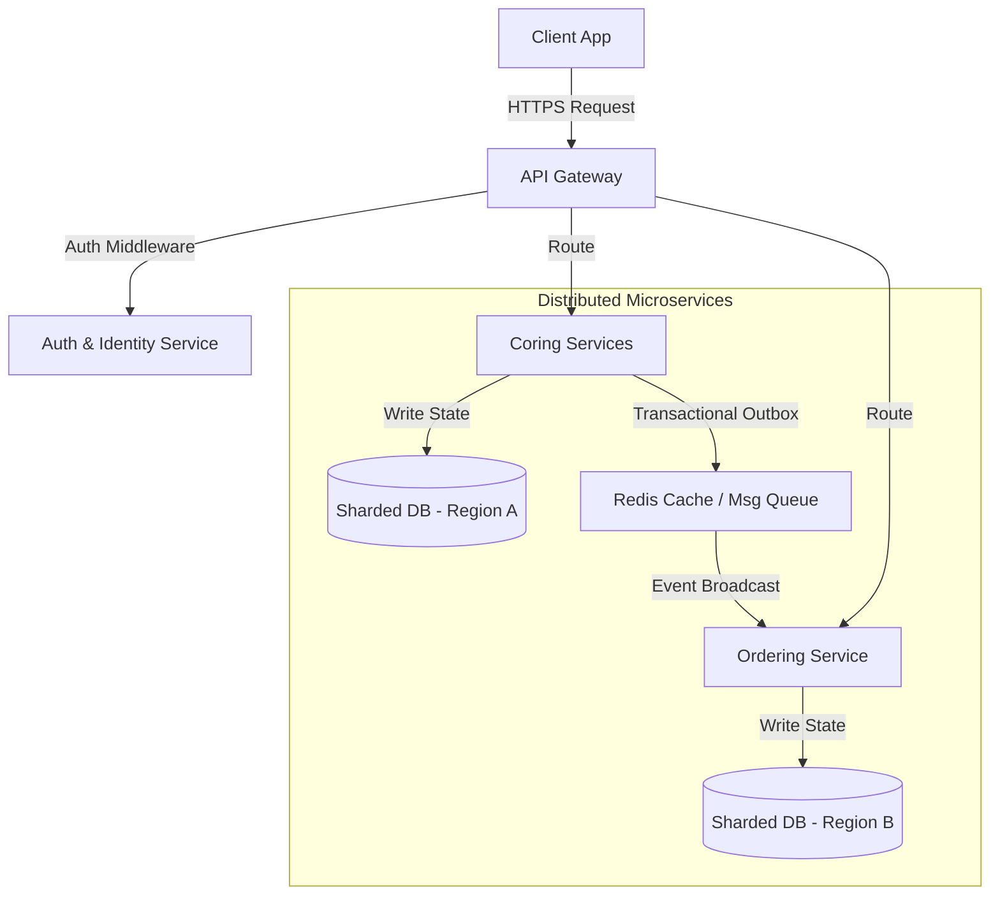

# Hey there, I'm Rahma! 👋

```
  ____        _  _    ____   _                 _      ____
 |  _ \ _   _| || |_ / ___| | |_  __ _   ___  | | __ |  _ \  ___ __   __
 | |_) | | | | ||  _|\___ \ | __|/ _` | / __| | |/ / | | | |/ _ \\ \ / /
 |  __/| |_| | || |_  ___) || |_| (_| || (__  |   <  | |_| |  __/ \ V /
 |_|    \__,_|_| \__||____/  \__|\__,_| \___| |_|\_\ |____/ \___|  \_/
```

** Full-Stack Engineer | Distributed Systems & High-Fidelity UI/UX Specialist**

Passionate about bridging the gap between scalable backends and premium user interfaces. I design high-throughput microservices, implement distributed consensus patterns, and craft pixel-perfect, highly interactive frontend experiences.

---

### 🚀 Technical Arsenal

<table>
  <tr>
    <td align="center" width="33%">
      <strong>Backend & Infrastructure</strong>
    </td>
    <td align="center" width="33%">
      <strong>Frontend & Design Systems</strong>
    </td>
    <td align="center" width="33%">
      <strong>Architecture & Patterns</strong>
    </td>
  </tr>
  <tr>
    <td valign="top">
      <ul>
        <li>Node.js / NestJS / Express</li>
        <li>PostgreSQL / MongoDB / Redis</li>
        <li>Microservices Architecture</li>
        <li>Docker / Local Dev Environments</li>
        <li>Secure Identity & Access (IGA)</li>
      </ul>
    </td>
    <td valign="top">
      <ul>
        <li>React.js / Next.js (App Router)</li>
        <li>TypeScript / JavaScript</li>
        <li>Tailwind CSS / Premium Glassmorphism</li>
        <li>RTL Support / Multilingual UI</li>
        <li>Reusable Design Components</li>
      </ul>
    </td>
    <td valign="top">
      <ul>
        <li>Region-Based DB Sharding</li>
        <li>Transactional Outbox Pattern</li>
        <li>Event-Driven Consistency</li>
        <li>State Machine Workflow Engines</li>
        <li>API Middleware & Security Layers</li>
      </ul>
    </td>
  </tr>
</table>

---

### 🛠️ Key Architectural Achievements

Here's a breakdown of advanced engineering solutions I have designed and implemented:



#### 📦 Distributed Microservices & Eventual Consistency
* **Region-Based Sharding**: Designed and developed region-based database sharding logic to partition load and minimize request latency for microservice ecosystems (`coring-services` and `ordering-service`).
* **Transactional Outboxing**: Eliminated dual-write risks by implementing the Transactional Outbox pattern, routing event streams through Redis-backed brokers for reliable, eventual data consistency.
* **Complex Workflow Engines**: Crafted collaborative workflow engines featuring automated state transitions (e.g. `'ready_for_review'`), notification dispatches, and robust query fallback mechanisms.

#### 🎨 Premium Dashboards & Interactive Interfaces
* **Design Systems (`@/shared/components`)**: Built modular, reusable UI design system atoms (dynamic buttons, starred multi-select fields, badges, custom input components) with pixel-perfect attention to micro-animations and accessibility.
* **Complex Multi-step Wizards**: Built advanced product builder wizards with live visual simulators (interactive SVG geographic radius map widgets, customized RTL schedules/days timeline accordion builders).
* **RTL Layout Optimization**: Specialized in building native Right-to-Left (RTL) Arabic web layouts with clean user flows and transition animations.

---

### 📈 GitHub Activities & Stats

<div align="center">
  
  
</div>

---

### 📂 Highlighted Repositories

#### 🌟 [Tunisia-Village-Dashboard](https://github.com/Rahma/Tunisia-Village-Dashboard)
> A premium dashboard UI built with Next.js App Router and TypeScript. Featuring reusable select inputs, customizable multi-step dashboards, map rendering with custom search radii, and dynamic accordion schedules.

#### ⚙️ [Coring & Ordering Services](https://github.com/Rahma/coring-services)
> A distributed backend engine featuring region-based sharding, transaction outboxing, authentication middleware, status change triggers, and Redis-backed caching strategies.

---

### 📫 Connect With Me

<div align="left">
  <a href="https://linkedin.com/in/your-profile" target="_blank">
    
  </a>
  <a href="mailto:your-email@example.com">
    
  </a>
</div>

***

*“Writing code is not just about making it work; it’s about making it resilient, scalable, and delightful.”*
